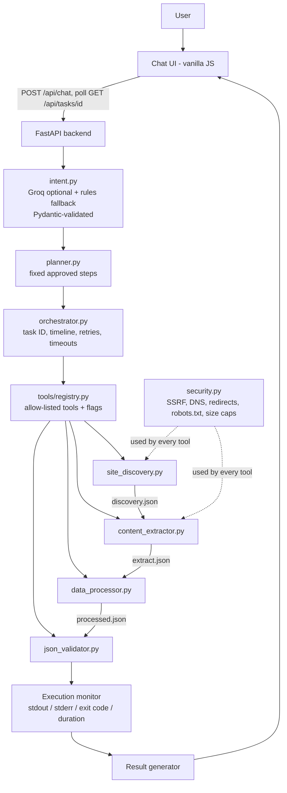

# WebPilot AI
**From Natural Language to Real Execution.**

WebPilot AI turns a plain-English request ("Crawl https://example.com, summarize it and give me JSON") into a validated execution plan, runs **approved CLI tools as real subprocesses**, captures their stdout / stderr / exit codes, validates the produced JSON and presents the evidence in a chat UI. Nothing in a result is invented: every field comes from a real HTTP fetch.

## Problem statement
Chatbots describe what they would do. Agents that run arbitrary model-written shell commands are unsafe. WebPilot AI sits in between: the model (optional) only *classifies intent*; a fixed planner picks steps; the orchestrator can run **only** the four allow-listed tools with allow-listed flags.

## Features
- Natural language → schema-validated intent → fixed, approved plan (Groq optional, deterministic fallback)
- 4 independent CLI tools, each runnable on its own: `site_discovery`, `content_extractor`, `data_processor`, `json_validator`
- Real subprocess execution (`shell=False`, argv lists, per-tool timeout, retries on transient failure)
- Live execution timeline driven by backend polling (steps are only "Completed" once the backend says so)
- Honest statuses: Completed / Partial Success / Failed, with warnings for skipped or empty pages
- Source-linked JSON (every heading, paragraph and link carries the page URL it came from)
- Extractive summary built from the crawled text; optional AI interpretation shown separately and labelled
- SSRF protection, robots.txt compliance, size/time limits, untrusted-content handling

## Architecture


## Technology stack
Python 3.11+, FastAPI, Uvicorn, Pydantic v2, Requests, BeautifulSoup4 (`html.parser`), `urllib.robotparser`, python-dotenv, Groq HTTP API (optional). Frontend: HTML5, CSS3, vanilla JavaScript. No database, no framework, no Docker.

## Folder structure
```
webpilot-ai/
├── backend/
│   ├── main.py            FastAPI app + endpoints
│   ├── intent.py          NL -> Intent (Groq optional, rules fallback)
│   ├── planner.py         Intent -> TaskPlan (approved steps only)
│   ├── orchestrator.py    subprocess execution, monitoring, retries, task state
│   ├── models.py          Pydantic models (intent, plan, extracted-data schema, API)
│   ├── security.py        URL validation, SSRF, robots.txt, safe_get
│   ├── ai.py              optional Groq client
│   ├── logger.py          logging with secret redaction
│   ├── tools/             registry.py + the four CLI tools
│   └── utils/helpers.py   paths, JSON I/O, exit-code contract
├── frontend/              index.html, style.css, script.js
├── outputs/               per-task working files (<task_id>/*.json) - git-ignored
├── tests/                 pytest suite (+ local fixture website)
├── DEMO_SCRIPT.md         video script + technical explanation
└── README.md
```

## Installation (macOS)
```bash
cd webpilot-ai
python3 -m venv .venv
source .venv/bin/activate
pip install -r requirements.txt
cp .env.example .env          # optional: add GROQ_API_KEY to enable the LLM
```

## Environment variables (`.env`)
| Variable | Purpose |
|---|---|
| `GROQ_API_KEY` | Optional. Enables Groq intent parsing + AI interpretation. Never logged, never passed to tool subprocesses. |
| `GROQ_MODEL` | Any currently supported Groq chat model id (default `llama-3.3-70b-versatile`; check Groq's model list, it changes). |
| `HOST`, `PORT`, `LOG_LEVEL` | Server settings (defaults 127.0.0.1, 8000, INFO). |

## Run
```bash
source .venv/bin/activate
python -m uvicorn backend.main:app --host 127.0.0.1 --port 8000
```
Open **http://127.0.0.1:8000** (the backend serves the frontend). API docs: http://127.0.0.1:8000/api/docs

## How CLI execution works
For each stage the orchestrator builds an argv list from the registry, e.g.
`[python, -B, backend/tools/site_discovery.py, --url, https://example.com, --max-pages, 3, --output, outputs/<task>/discovery.json]`
and calls `subprocess.run(argv, shell=False, capture_output=True, timeout=..., env=<minimal env>)`. It records stdout, stderr, exit code, duration and attempt number, and passes data to the next stage through JSON files in `outputs/<task_id>/`.
Exit-code contract: `0` ok · `1` failure · `2` rejected input · `3` robots.txt disallows · `75` transient (retried up to 2 times).

Run any tool by hand:
```bash
python backend/tools/site_discovery.py   --url https://example.com --max-pages 3 --output outputs/demo/discovery.json
python backend/tools/content_extractor.py --discovery-file outputs/demo/discovery.json --max-pages 3 --output outputs/demo/extract.json
python backend/tools/data_processor.py   --input outputs/demo/extract.json --output outputs/demo/processed.json
python backend/tools/json_validator.py   --input outputs/demo/processed.json
```
Call the API directly:
```bash
curl -s -X POST localhost:8000/api/chat -H 'content-type: application/json' \
  -d '{"message":"Crawl https://example.com, extract important information, summarize the website, and return the result in JSON."}'
```
(`"wait": false` returns `202` immediately; poll `GET /api/tasks/{task_id}` — this is what the UI does.)

## Example prompts
- Crawl https://example.com, extract important information, summarize the website, and return the result in JSON.
- Find the main headings and links on https://www.python.org (single page)
- Extract publicly available contact information from https://www.iana.org
- Compare information from up to 3 pages of https://www.rfc-editor.org

## Sample output schema
```json
{
  "url": "https://example.com/", "title": "", "meta_description": "",
  "headings":   [{"level": 1, "text": "", "source": "https://..."}],
  "paragraphs": [{"text": "", "source": "https://..."}],
  "internal_links": [{"text": "", "url": "", "source": "https://..."}],
  "pages_crawled": 1, "sources": ["https://example.com/"],
  "pages": [{"url": "", "title": "", "heading_count": 0, "paragraph_count": 0, "word_count": 0}],
  "crawl_errors": [], "summary": "", "summary_basis": "Extractive: ..."
}
```
API response: `task_id, status, intent, execution_plan, execution_steps, cli_results, summary, extracted_data, json_valid, ai_interpretation, warnings, errors, duration_ms`.

## Security measures
- No `shell=True`, no `os.system`, no model-written commands. A test scans the source for them.
- Allow-listed tool registry **and** allow-listed flags per tool; model output is schema-validated (`extra="forbid"`), its URL must literally appear in the user's message, and its steps are ignored in favour of the fixed pipeline.
- SSRF: only http/https; rejects credentials in URLs, `localhost`/`.local`/`.internal`, odd ports, and any host that resolves to a private, loopback, link-local, CGNAT, multicast or reserved address (incl. IPv4-mapped IPv6). DNS is validated and **every redirect hop is re-validated**.
- robots.txt honoured for every fetched page (5xx on robots.txt = do not crawl); clear User-Agent; 0.5 s politeness delay.
- Limits: 3 pages, 2 MB per response, connect/read timeouts, per-tool subprocess timeouts, max 4 concurrent tasks, HTML/XHTML content types only.
- Website text is untrusted data: scripts/styles stripped, rendered with `textContent` only (no `innerHTML`), CSP header, and fed to the LLM inside an "untrusted data" envelope.
- Child processes get a minimal environment (no `GROQ_API_KEY`); output paths must be inside `outputs/`; task ids are validated `[a-f0-9]{32}`; secrets are redacted from logs; `.env` is git-ignored.

## Testing
```bash
source .venv/bin/activate
python -m pytest tests -q
```
77 tests: intent rules and AI-output rejection, SSRF/URL validation, redirect re-validation, registry allow-listing, JSON validator, plus end-to-end runs against a local fixture site (full pipeline, robots, retries on transient failure, inaccessible host, HTTP 503, empty page, hostile page text), partial success, tool timeouts, a failing processing stage with partial results preserved, the mocked Groq path, secret isolation and report persistence.
The e2e tests need to crawl `127.0.0.1`, so they set `WEBPILOT_ALLOW_PRIVATE_TEST=1`, a **test-only** switch that relaxes SSRF checks. Never set it when running the real app.

## Known limitations
- No JavaScript rendering: pages built client-side may come back empty (reported as a warning).
- One URL per request (extra URLs are noted and ignored); max 3 pages; extractive summaries are plain, not fluent prose.
- DNS is validated before each request but `requests` resolves again when connecting (a DNS-rebinding race is theoretically possible; pinning the resolved IP would close it).
- Hostnames must resolve through local DNS; on networks where only a proxy can resolve names, validation will reject them.
- Task state is in memory (finished reports are also saved to `outputs/<id>/report.json`); no auth or rate limiting — intended for local demo use.
- The Groq code path (intent + interpretation) was written against Groq's documented OpenAI-compatible API but could not be exercised with a real key during development; its validation/fallback logic is covered by unit tests with mocked responses.

## AI tools and external services used
- **Groq API** (optional): intent structuring and a clearly labelled interpretation paragraph.
- **Claude (Anthropic)** assisted in writing this codebase.
- No other external services; crawling uses plain HTTP to the sites you request.
